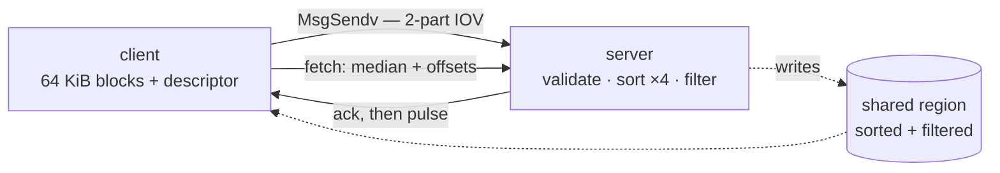
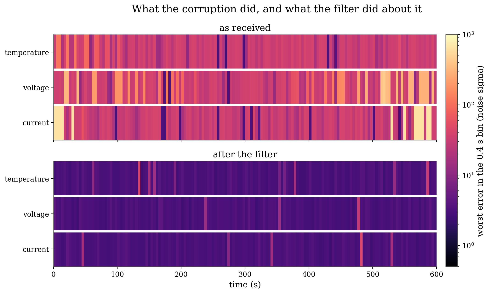
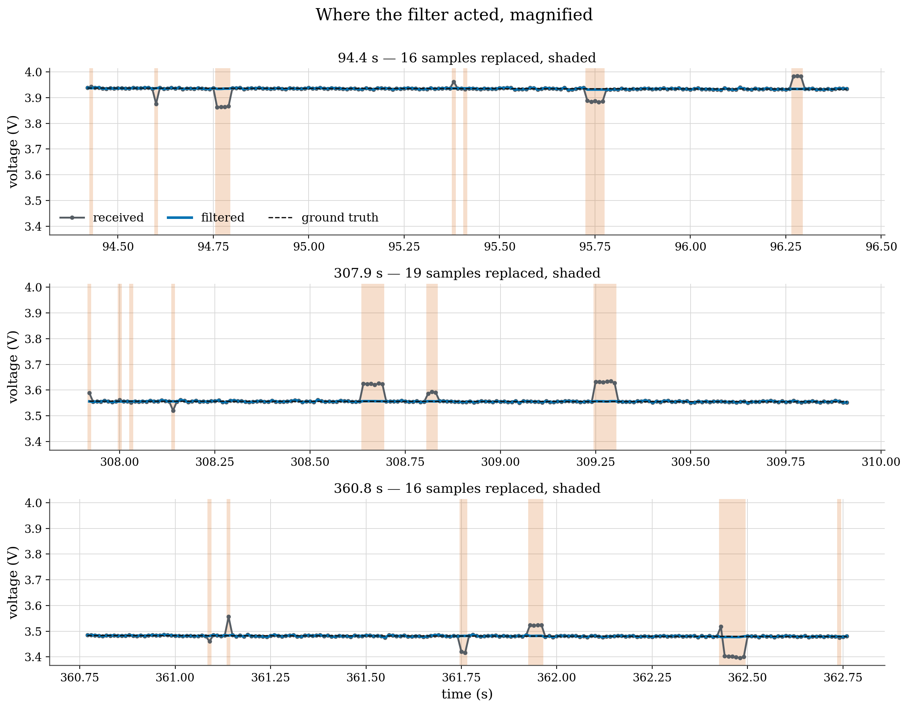
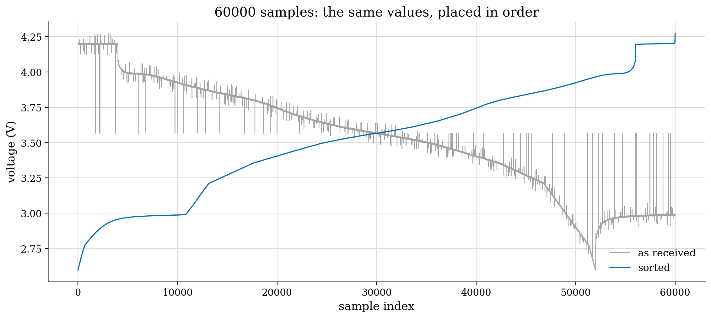

# Real-Time Multi-Core Sorting and Median Filter Service

[](docs/IMPLEMENTATION.md)
[](docs/FINAL-RUN.md)
[](RT-MOMS/app)
[](#testing)

[](docs/IMPLEMENTATION.md)
[](run-figures/error_map.png)
[](#documentation)

A QNX client/server service for on-line sensor telemetry. The client offloads
64 KiB blocks of unsorted float32 readings; the server validates each block with an
FNV-1a seal, sorts it with a four-thread parallel merge sort, removes outliers with
a rolling Hampel median filter, and signals completion with a **QNX pulse** — the
client then fetches the median and a memory-offset descriptor pointing into a shared
results region.

Everything runs on a Raspberry Pi 4 from a single boot image: the two programs, the
seven test suites, the three measurement scripts and the payload.

## Results

Measured on the Raspberry Pi 4, `ifs-rpi4.bin`, SHA-256 `2ac01f08…31fc9d8b`.

| | |
| --- | --- |
| One 64 KiB block sorted, 4 workers | **0.80 ms** (2.40 ms on one worker) — **3.00×** |
| Server stage per block | 7.5 ms at filter width 9; **12.2 ms at width 15** |
| Error against ground truth, width 15 | **12.1× / 18.6× / 3.67×** RMSE on voltage / current / temperature |
| Clean channel | **0 replacements**, byte-identical in and out |
| Tests | **9 150 checks**, 0 failed, 0 skipped — host *and* board |
| Repeatability | 20-run soak, **20 identical medians**, 7.21 ms service time/block |
| Real-time headroom | one block = 163.84 s of signal at 100 Hz, sorted in 0.80 ms |

The rolling filter's width was chosen from a board sweep, not assumed: recall and
RMSE gain both plateau at **15**, and past it the block time doubles and triples for
a third of a point. Recall at width 15 is 98.6 % of injected samples, and the
dataset's worst bursts (6 samples) fit inside its half-window.

## How it works



- **One delivery, two items.** The 48-byte descriptor and the 64 KiB block travel as
  an IOV, so the server can validate the header before pulling the payload — no
  64 KiB receive buffer just to learn the size.
- **The ack comes before the pulse.** An `rcvid` dies once it is replied to, so the
  client supplies its own connection and receives the asynchronous pulse later.
- **Two buffers, not one.** Sorting destroys time order and the filter needs it, so
  the filter runs on a time-ordered copy; the sorted copy yields the block median as
  a by-product.
- **Results leave through shared memory.** 128 KiB of arrays would be copied twice
  as messages; instead the region holds them and the reply carries byte offsets and
  a seal per array.

## Figures







## Repository layout

| Path | Contents |
| --- | --- |
| `RT-MOMS/app/` | the service: sensor, block loader, protocol, client, server, parallel merge sort, median filter, shared region |
| `RT-MOMS/tests/` | six test suites plus the KPI benchmark |
| `RT-MOMS/board/` | three board scripts: sweep, client deadline, soak |
| `RT-MOMS/images/` | the image build and `ifs-rpi4.bin` |
| `data/` | PyBaMM dataset generator — payload and answer key |
| `tools/` | `filter_sweep.py` (scores a sweep), `result_plots.py` (report figures) |
| `run-figures/` | the published figures from the final board run |
| `report/` | the report template, converted to LaTeX |
| `presentation/` | the Beamer deck |
| `docs/` | implementation, study guide, reproduction, testing, final run, changelog |

## Build and run

```sh
# Host: build and run the six suites — 9 150 checks
cd RT-MOMS/tests && make check

# Board: cross-compile everything and build the boot image
cd RT-MOMS && make
```

Flashing the image and the full six-step board run are in
[docs/FINAL-RUN.md](docs/FINAL-RUN.md); the host-side reproduction is in
[docs/REPRODUCE.md](docs/REPRODUCE.md).

## Testing

Two folds, one set of sources. The host builds the suites with `gcc`; the board
builds the *same* files with `qcc -Vgcc_ntoaarch64le`. Both return the same counts:

| Suite | Checks | What it establishes |
| --- | --- | --- |
| `test_protocol` | 186 | the wire contract: 64 KiB, safe message numbers, seal sensitivity, region arithmetic |
| `test_sensor` | 642 | a file behaves like a device: both layouts agree, frames capped, clock exact, junk refused |
| `test_block_loader` | 116 | a stream becomes blocks that survive the trip, split and sealed correctly |
| `test_mergesort` | 578 | sorted, same multiset, byte-identical for 1/2/3/5/8 threads |
| `test_median` | 7 615 | the Hampel filter against a reference, across seams, bursts and bad arguments |
| `test_shared_memory` | 13 | the results region's bounds and arithmetic |
| `test_kpi` | 79 | sort/filter/merge timing at 1/2/4 workers, global median two ways |

The evidence is four kinds: **two independent routes** (planar vs interleaved, one
sample at a time vs whole blocks), an **oracle** (`qsort`), **invariants** (ordered,
same multiset, stable across thread counts, seals match), and **deliberate bad
input** (a 3-byte file, a nudged sample, an unknown job id) that must be refused.

## The dataset

Three PyBaMM recordings of one LG M50 cell at 0.5C / 1C / 2C — 60 000 samples ×
four channels (time, voltage, current, temperature) — with Gaussian noise plus 1.5 %
impulsive corruption: spikes, bursts of up to 6 samples, dropouts of up to 4. The
clean signal and the injection mask are kept as the answer key. Per-run statistics
and the generator's history are in [CHANGELOG.md](CHANGELOG.md).

## Documentation

| Document | What it is for |
| --- | --- |
| [IMPLEMENTATION.md](docs/IMPLEMENTATION.md) | every stage, its code, its mechanism, its tests and its measured number |
| [STUDY-GUIDE.md](docs/STUDY-GUIDE.md) | a plain-language companion organised by milestone, for demos and viva |
| [REPRODUCE.md](docs/REPRODUCE.md) | the host-side commands that rebuild everything |
| [TESTING.md](docs/TESTING.md) | the measurement procedures and how to read their output |
| [FINAL-RUN.md](docs/FINAL-RUN.md) | the six-step board run sheet and its expected output |
| [CHANGELOG.md](CHANGELOG.md) | what changed, and why |

## Authors

Built for **26ELC331 Real-Time Operating Systems**, Amrita Vishwa Vidyapeetham,
Coimbatore.

| Author | LinkedIn | GitHub |
| --- | --- | --- |
| **Anmol Govindarajapuram Krishnan** | [in/anmolkrish](https://www.linkedin.com/in/anmolkrish/) | [@Anmol-G-K](https://github.com/Anmol-G-K) |
| **Mauli Rajguru** | [in/maulir](https://www.linkedin.com/in/maulir/) | [@maulir](https://github.com/maulir) |
| **Sanjay TS** | [in/sanjay-t-s](https://www.linkedin.com/in/sanjay-t-s-b272aa321/) | [@Sanjay5421](https://github.com/Sanjay5421) |
