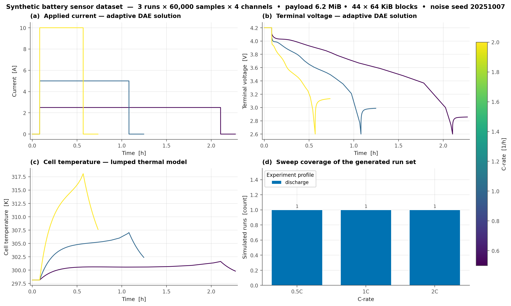
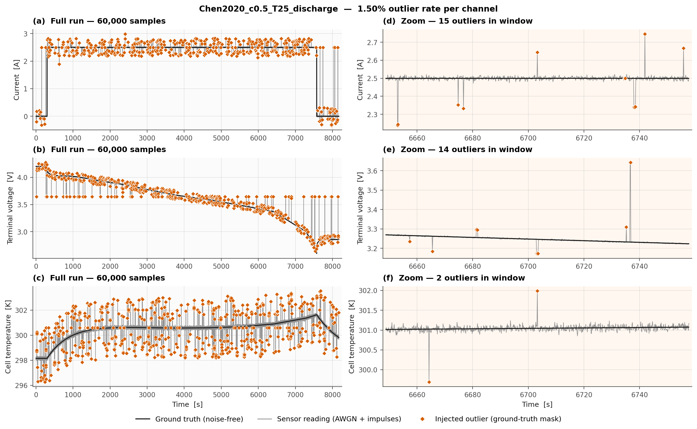
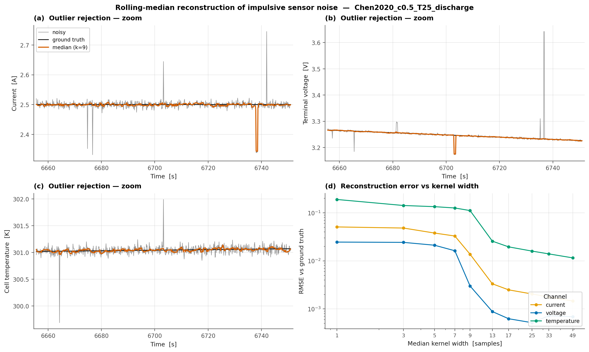
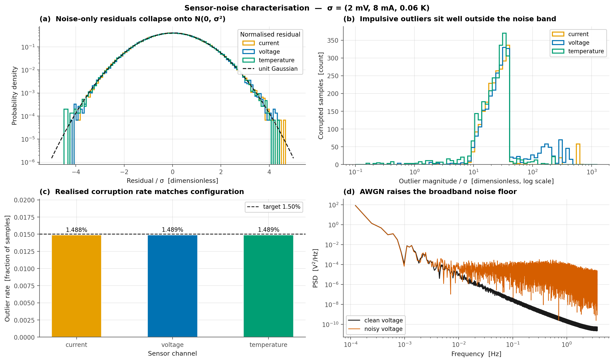
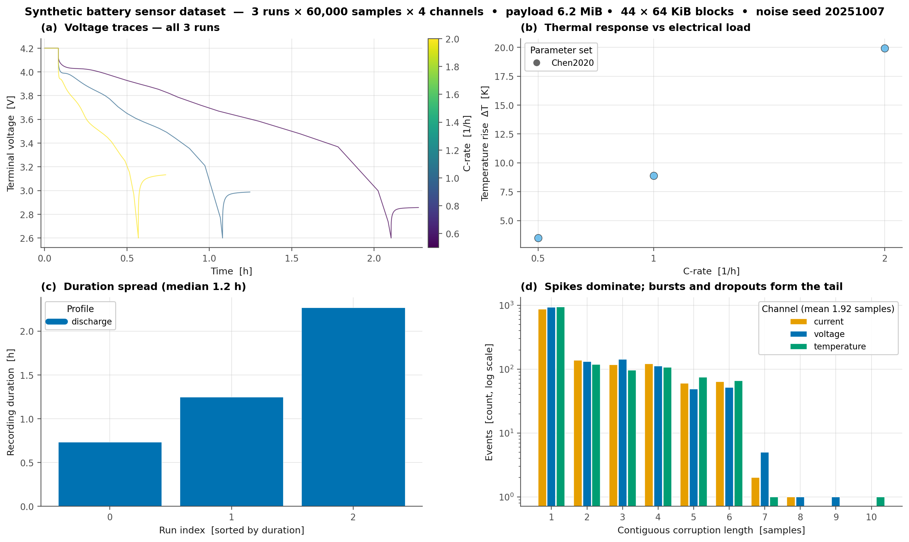

# Real-Time Multi-Core Sorting and Median Filter Service

The client continuously offloads unsorted floating-point time-series metrics (≥ 64 KB) to the server. The server implements a parallel Merge-Sort algorithm across multiple worker threads, using mutexes and condition variables to control the recursive merging phases across partitioned memory. In addition, the server computes rolling median filters to eliminate sensor outliers. On completion, the server sends a QNX pulse event back to the client with the calculated median and memory-offset descriptor.

The workload this service is built around is synthesised offline, so it can be
replayed at realistic volumes with a known ground truth: multi-channel battery
recordings carrying Gaussian sensor noise and impulsive outliers, together with
the injection mask a median filter can be scored against.

## Repository layout

| Path | Contents |
| --- | --- |
| `README.md` | this file |
| `CHANGELOG.md` | what changed, and why |
| `RT-MOMS/` | the QNX side: the service sources in `app/`, the host tests in `tests/`, the board scripts in `board/`, the board support package with the boot image in `images/` |
| `docs/` | the documents: `IMPLEMENTATION.md` (how each stage works, in pipeline order, with diagrams), `TESTING.md` (every test, and how to run it), `REPRODUCE.md` (every build and run command), `FINAL-RUN.md` (the integrated board run), `STUDY-GUIDE.md` (the project in plain language), `milestones-draft.md`, and the assignment and report template |
| `tools/` | `result_plots.py` turns a run's files into the report figures — sorting, filter quality, zooms and the error map — against the dataset's ground truth; `filter_sweep.py` scores a width or worker-count sweep from the board |
| `data/` | PyBaMM generator for the synthetic client payload (`src/battery_dataset/`) |
| `data/artifacts/dataset/` | generated payload — `.npz`, manifest, CSV (git-ignored, ≈ 20 MiB) |
| `data/artifacts/figures/` | generated diagnostic figures (committed; shown below) |
| `legacy/` | the first, standalone loader experiment — superseded by `RT-MOMS/tests/sensor_demo.c` |
| `run-figures/` | figures produced from a board run (git-ignored; regenerable from the run's files) |
| `presentation/` | the Beamer deck for the demo |

## Generating the dataset — one command

```bash
cd data
uv run python -m battery_dataset
```

That command does everything: solves the simulations, injects the sensor noise,
writes the `.npz` payload, the `metadata.json` manifest and every CSV, and
renders the figures. `uv run battery-dataset` is the equivalent console script.
`uv` installs PyBaMM, NumPy and Matplotlib on first run, so there is no manual
setup. The build takes about 20 s.

| Flag | Effect |
| --- | --- |
| `--quick` | same 3 recordings at 4 000 samples, for a fast smoke build |
| `--runs N` | limit the number of recordings |
| `--samples N` | samples per recording |
| `--seed N` | outlier RNG seed |
| `--output-dir DIR` | write artefacts somewhere else |
| `--no-csv`, `--no-bin`, `--no-plots` | skip the CSV rendering / the binary export / the figures |

The generator is split into small modules (`config`, `simulate`, `noise`,
`dataset`, `csvio`, `plot`) rather than one long script. It stays a package
because `uv` needs `pyproject.toml` to pin those dependencies anyway, and the
single command above is unchanged either way.

## What a recording is

Every recording is one PyBaMM simulation: a single-particle model (`SPM`) with a
lumped thermal submodel, which yields three sensor channels over time — current,
terminal voltage and cell temperature. There are **three recordings, one per
C-rate**, on the same cell at 25 °C, each discharged from full to the lower
cut-off. Holding the cell, the ambient temperature and the experiment fixed
leaves the load as the single variable, so the three recordings are directly
comparable and visibly different:

| Recording | C-rate | Current | Duration | Temperature rise |
| --- | --- | --- | --- | --- |
| `Chen2020_c0.5_T25_discharge` | 0.5C | 2.5 A | 2.27 h | 3.5 K |
| `Chen2020_c1_T25_discharge` | 1C | 5.0 A | 1.25 h | 8.9 K |
| `Chen2020_c2_T25_discharge` | 2C | 10.0 A | 0.74 h | 19.9 K |

Each recording is resampled onto a fixed 60 000-sample grid, giving a
`(3, 60000, 4)` tensor over the channels `time_s, current_A, voltage_V,
temperature_K`.

| Quantity | Value |
| --- | --- |
| Recordings | 3 |
| Samples per recording | 60 000 |
| Sample rows in total | 180 000 |
| Duration | 0.74 h – 2.27 h (median 1.25 h) |
| Temperature rise | 3.5 K – 19.9 K |
| `.npz` payload | 6.2 MiB = 44 × 64 KiB blocks |
| CSV files | 4 (3 recording files + 1 index) |

## How it is corrupted

`time_s` is never touched. Each sensor channel gets additive white Gaussian
noise — voltage 2 mV, current 8 mA, temperature 0.06 K — plus impulsive
outliers: single-sample spikes, contiguous bursts, and stuck readings that hold
a constant value. Spikes are 10–40 σ, far outside the noise band, and the outlier
rate is 1.5 % of samples per channel (2 679 / 2 681 / 2 680 corrupted samples
for current / voltage / temperature, 8 040 in total). These are exactly the
artefacts a rolling median filter is meant to remove, and the injected mask is
stored alongside the corrupted readings so the removal can be measured rather
than judged by eye.

Noise placement is seeded per run, so regenerating produces the same dataset.

## Cell selection

The recordings use the **LG M50** (`Chen2020`). It is the best-evidenced of the
PyBaMM parameter sets and has by far the strongest thermal signal, so the
temperature channel carries a real measurement rather than mostly noise:

| Parameter set | Cell | Capacity | Temperature rise at 2C |
| --- | --- | --- | --- |
| `Chen2020` | LG M50 | 5.000 Ah | 19.9 K |
| `Mohtat2020` | graphite/NMC532 pouch | 5.000 Ah | 5.8 K |
| `Ai2020` | Enertech cell | 2.280 Ah | 7.4 K |

The last two are supported drop-in alternatives — a one-line change to
`parameter_sets` in `config.py` — but are not used by default, since three
recordings at different loads is already enough variance for the median-filter
workload.

Rejected entirely: `OKane2022` / `ORegan2022` (the same LG M50 cell as
`Chen2020`, so they would duplicate a cell rather than add variety);
`Marquis2019`, `Ecker2015`, `NCA_Kim2011` (temperature rise of 0.61 K, 0.23 K
and 0.01 K — below the 0.06 K noise floor, so the channel would be
noise-dominated); `Prada2013`, `Ramadass2004`, `Xu2019`, `MSMR_Example` and the
half-cell sets (no cell volume, cooling area or heat-transfer coefficient, so
the thermal model cannot be solved); `Sulzer2019` (lead-acid, not lithium-ion).

## Outputs

```
data/artifacts/
├── dataset/
│   ├── battery_sensor_dataset.npz     # clean, noisy, outlier_mask, duration_s, run_ids
│   ├── metadata.json                  # build config, cell identity, shapes, per-run stats
│   ├── csv_index.csv                  # manifest of the 3 recording CSVs
│   ├── csv/<run_id>.csv               # 3 files, one per recording
│   ├── bin/<run_id>[.truth].bin       # 6 interleaved files
│   └── bin/channels/r<idx>_<ch>.bin   # 12 per-channel files + manifest.txt
└── figures/                           # 5 PNGs, shown below
```

**CSV files — 4 in total**: 3 recording files plus one index. Each recording
file has 60 000 rows (one sample per row) and 11 columns, so it is
self-contained and can be read without Python:

```
sample_index, time_s, current_A, voltage_V, temperature_K,     ← clean / ground truth
current_A_noisy, voltage_V_noisy, temperature_K_noisy,          ← what the sensor reports
outlier_current, outlier_voltage, outlier_temperature           ← 1 where a spike was injected
```

The `.npz` is the primary artefact (compact, exact); the CSVs reproduce it
column for column.

**Binary files — 18 in total**, in two layouts. Both are headerless,
little-endian float32.

*Per channel* (12 files + a manifest): `bin/channels/r<index>_<channel>.bin`,
one flat run of 60 000 samples per channel — `time`, `current`, `voltage`,
`temperature` — at 240 000 bytes each. `manifest.txt` maps each `r<index>`
prefix to its recording id. This is the layout `qnx_project/loader.c` reads: a
whole file is one signal, so a min/max over it is meaningful.

*Interleaved* (6 files): `<run_id>.bin` is the sensor record (AWGN plus
impulsive outliers, what the service consumes) and `<run_id>.truth.bin` the
clean ground truth. Fixed 16-byte stride, so a reader seeks straight to sample
*n* at `n * 16`:

```
record = [time_s, voltage_V, current_A, temperature_K]     # 4 x float32 LE = 16 bytes
```

960 000 bytes each, readable straight into `struct { float t, v, i, temp; }`.
Note the two layouts order their values differently: the interleaved record is
time/voltage/current/temperature, while the per-channel files carry the dataset's
own time/current/voltage/temperature order in their filenames. Both layouts are
declared in `metadata.json` under `binary_export`.

Two caveats worth stating plainly. The `outlier_*` flags are the **injected
ground truth**, not the output of a detector — no outlier detection is
implemented yet, so these columns are the answer key, not a result. And the
median filter exists as a reference implementation used only to draw figure 03;
nothing filtered is persisted to disk.

## Figures

### 01 — Signal overview

One current, voltage and temperature trace per C-rate, plus a bar chart showing
how many recordings were produced for each C-rate.



### 02 — Noise injection

The key picture: one recording, all three channels, whole recording and zoomed
in — clean truth, the noisy reading, and every injected outlier marked. This is
what justifies a median filter: the spikes are large and isolated.



### 03 — Median filter recovery

The same zoom with a rolling median applied, next to the reconstruction error as
the kernel widens. Voltage has a clear sweet spot around 9 samples; current and
temperature keep a residual floor because a median across a step or a ramp is
biased. Filter output is computed for this figure only and is not saved.



### 04 — Noise statistics

Evidence that the corruption is what it claims to be: residuals collapse onto a
Gaussian, outlier magnitudes sit at 10–40 σ, the realised 1.5 % rate matches the
configured one, and the noise raises the broadband floor of the voltage
spectrum.



### 05 — Run gallery

How much the recordings vary: all three voltage traces coloured by C-rate,
temperature rise against C-rate, the duration spread, and the spike / burst /
dropout length distribution.


