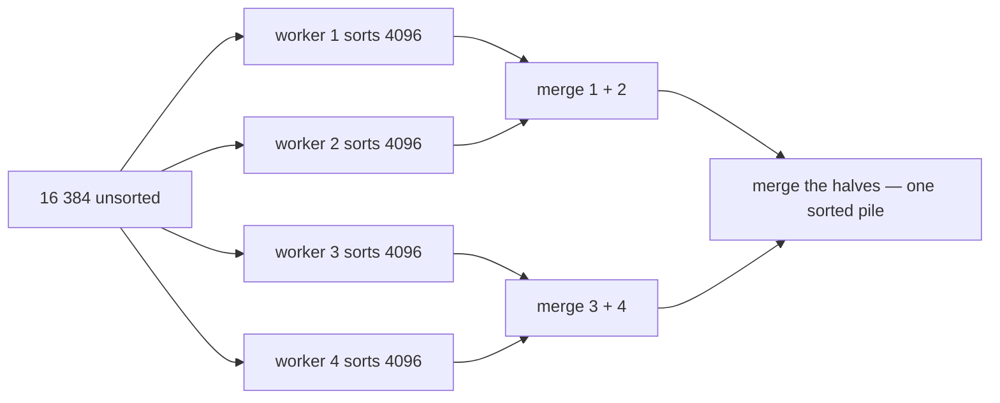

# Study and presentation guide

A plain-language companion to this project: what each piece is, why it exists,
and what to say about it. Read it before a demo, a viva or a report-writing
session. The precise version of everything here is in
[IMPLEMENTATION.md](IMPLEMENTATION.md), and the commands are in
[REPRODUCE.md](REPRODUCE.md).

**Where we are today:** M1 and M2 are built and verified on the Raspberry Pi.
M3 is the next piece of work. The protocol half of M4 is already written and
tested; only the wiring is missing. This file grows with the milestones — when
M3 lands, the section below stops saying "next" and says what was actually built.

---

## The project in one breath

A client keeps handing a server chunks of sensor readings. The server sorts each
chunk with several threads at once and cleans up glitches with a rolling median,
then taps the client on the shoulder to say the answer is ready — and the client
comes back to collect the median and the address of the results.

Five ideas carry the whole thing:

| Idea | In plain words |
| --- | --- |
| 64 KB parcels | The unit of work is one parcel of data, never a whole file |
| Descriptor | Every parcel travels with a label: what is inside, and a seal that proves it arrived intact |
| Parallel merge sort | Four workers sort four piles, then merge until one sorted pile is left |
| Rolling median | Look at a small window of neighbouring readings; the middle value is the truth, a spike is not |
| Pulse | The server does not make the client wait — it taps it when the work is done |

---

## Milestone 1 — deciding what to send *(done)*

**The question it answers:** what exactly does the client hand over?

**The answer:** a parcel of 16 384 numbers, exactly 64 KB, with a label.

- 16 384 numbers × 4 bytes each = 65 536 bytes = exactly 64 KB. Nothing is
  padded and nothing is oversized, so the "at least 64 KB" requirement is met by
  construction.
- Our recording holds 60 000 readings, so it becomes **three full parcels plus
  one small one** (10 848 readings) — like filling three crates and finishing
  with a half crate.

**Why the label matters.** Sorting the wrong numbers, or worse, sorting damaged
numbers, produces a confident wrong answer. So the label records which parcel
this is, which reading it starts at, how many numbers are inside, and a **seal**:
a checksum, one number computed from the contents. The server recomputes it and
rejects the parcel if it does not match, instead of quietly sorting garbage.

From the real data: parcel 0 holds readings 0…16 383, its smallest value is
3.5662 V, its largest is 4.274 V, and its seal is `0xe90d24d2`. Change one digit
anywhere inside and the seal changes.

**Why two file layouts** (a flat file per channel, and one interleaved record):
a spreadsheet column versus a spreadsheet row. Sorting a column is meaningful;
a row mixes four different signals — time, voltage, current, temperature — so
the code that pulls a "column" out of a "row" file has to know the order. There
is a test that both layouts produce byte-identical parcels, which is the safety
net for that order.

**If they ask**

- *Why 64 KB and not 1 MB?* The assignment asks for at least 64 KB per
  operation, and a parcel this size still fits comfortably in cache and keeps a
  single job's latency low.
- *What if a reading is corrupted on the way?* The seal catches it. The client is
  told the parcel was refused and retries, rather than the server sorting it.
- *What is actually inside the file?* Raw 32-bit floating-point numbers, no
  header, no CSV — the recording itself.

---

## Milestone 2 — sorting with several workers *(done, verified on the board)*

**The question it answers:** how do you sort 16 384 numbers quickly, and how do
you prove the answer is right?

**The idea in one picture.** Four workers each sort a quarter, then merge.

**Merging two sorted piles** is what makes this cheap: look at the top card of
each pile, take the smaller one, repeat. Pile `[1, 4, 9]` and pile `[2, 3, 7]`
become `1, 2, 3, 4, 7, 9`. Nothing is ever compared against the whole pile.

**The part that needs care.** A merge cannot start until *both* piles it merges
are finished. So the workers need a rule: nobody starts the next round until
everyone has finished this one. That rule is what the mutex and the condition
variables implement — a shared scoreboard, where the last worker to finish rings
a bell and the manager waits for the bell instead of guessing with a sleep.
Nothing is timed, so a slow machine produces the same answer as a fast one.

**Why the answer stays predictable.** Equal numbers keep their original order,
so the same input gives byte-identical output whatever the worker count — tested
with 1, 2, 3, 5 and 8 threads.

| Workers | What the program reports | Time per parcel (board) |
| --- | --- | --- |
| 1 | 1 partition, 0 merge phases, 1 task | 2.278 ms |
| 2 | 2 partitions, 1 merge phase, 3 tasks | 1.253 ms |
| 4 | 4 partitions, 2 merge phases, 7 tasks | 0.757 ms |

One parcel is 163.84 seconds of sensor data at 100 Hz, and it is sorted in
0.757 ms — about **200 000 times faster than the data arrives** — with four
workers doing 3.01× the work of one. The plan line changing shape with the worker
count is how you show the parallel path really ran, rather than a faster serial
one.

**If they ask**

- *Why not sort the whole recording in one go?* The service is a streaming one:
  the client offloads continuously, so the natural unit is a parcel.
- *Where do the numbers live while they are being sorted?* In a scratch buffer of
  the same size, allocated once per sort and flipped back and forth between
  phases — no allocation per merge.
- *How do you know the sort is correct?* Every test compares the result with the
  standard library's `qsort` on the same numbers, and the demo re-checks that each
  parcel came out in order.

---

## Milestone 3 — the two programs talking *(next)*

**The question it answers:** how does the data reach the server, and how does the
answer come back?

- **Knocking by name.** The client asks for the service by name (`sortmed`),
  which is the only connection method the assignment allows. If the server is not
  up yet it keeps trying for ten seconds and then exits with a clear message
  instead of hanging.
- **One delivery, two items.** The label and the parcel travel together as a
  two-part list, so neither side has to glue them into a single 64 KB buffer.
- **The receipt comes before the tap**, deliberately: the client cannot hold its
  line open waiting for a late tap, so the server says "accepted" straight away
  and the client then listens on its own channel for the tap.
- **The tap is tiny.** It carries one number — the job id — like a buzzer rather
  than a letter. That is why the client asks for the details afterwards.
- **The results are left in a shared area of memory.** A sorted block plus a
  filtered block is 128 KB, and pushing that back through messages would copy it
  twice for nothing. So the server writes both into one named shared region — the
  same memory, seen by both programs — and the client reads them there. The reply
  only says *where*: which region, the two byte offsets, how many values, and a
  seal per array. That "where" is what the project statement calls the
  memory-offset descriptor.
- **The rolling median** is the cleanup step: for each reading, look at a small
  window of neighbours and take the middle value. Readings `5, 5, 5, 50, 5`
  average to 14 — the spike drags the average — but their median is 5, which is
  what the sensor really saw. The number of spikes removed is reported too.
- **Why a copy is filtered.** Sorting scrambles the time order, and the filter is
  entirely about time order, so the two run on different buffers.

**If they ask**

- *Why is the server separate from the client?* That is the assignment's
  architecture, and how a QNX system is meant to be built: separate processes
  talking by messages, so a crash or a restart on one side is survivable.
- *What if the client is not listening when the tap arrives?* It does not matter.
  A pulse lands on a channel and waits there; the client is not holding anything
  open for it.
- *Median or average?* Median, because a single spike moves an average and cannot
  move a median.

---

## Milestone 4 — the tap, and proving it *(protocol ready, wiring to do)*

- The tap (`PROTO_PULSE_DONE`) is the asynchronous event the assignment asks for:
  the server *tells* the client, and the client does not sit polling for an
  answer.
- The answer carries exactly what the project statement promises: the **median**,
  plus a **memory-offset descriptor** — which shared region, at which byte
  offsets, how many values, and a seal over each of the two arrays — along with
  the window width, the number of outliers removed, and how long the server took.
- That last figure, `elapsed_ns`, is what the timing half of the report is built
  from: same work, more workers, less time.

---

## Numbers to have ready

| Fact | Value |
| --- | --- |
| One parcel | 16 384 numbers = exactly 64 KB |
| One recording | 60 000 readings = 3 full parcels + 10 848 |
| Sort plan with 4 workers | 4 partitions, 2 merge phases, 7 tasks |
| Time per parcel on the board | 0.757 ms (one worker: 2.278 ms, so 3.01×) |
| Speed versus the data | 163.84 s of signal sorted in 0.757 ms ≈ 200 000× real time |
| Tests | 48 tests, 1473 checks on the host; the sort's 578 also pass on the board |
| Boot image | 37 610 936 B — seven programs and the data inside one file |

---

## A five-line version, if you get sixty seconds

> The client replays sensor data and offloads it in 64 KB parcels. Each parcel
> carries a label with a checksum, so the server can refuse anything damaged. The
> server sorts a parcel with four threads — divide it into quarters, sort each,
> then merge until one sorted pile remains — and filters it with a rolling median
> to drop sensor spikes. When it is finished it taps the client with a pulse, and
> the client fetches the median and the address of the results. On the Raspberry
> Pi one parcel takes 0.757 ms with four workers against 2.278 ms with one.
