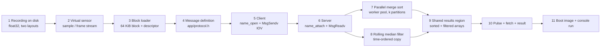
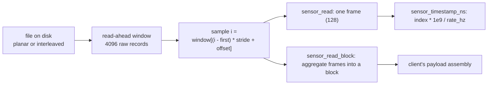
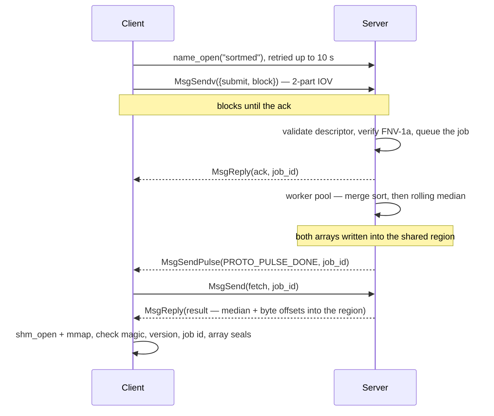
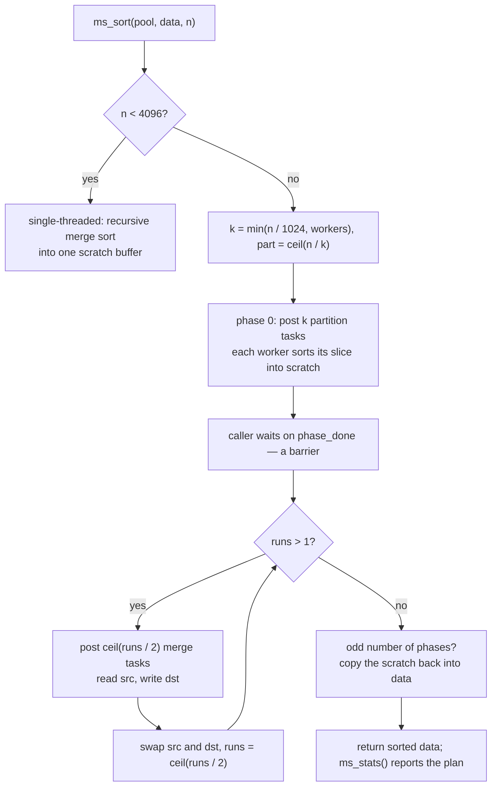
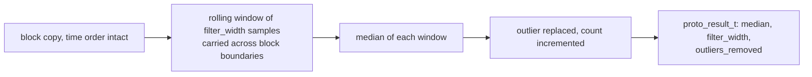
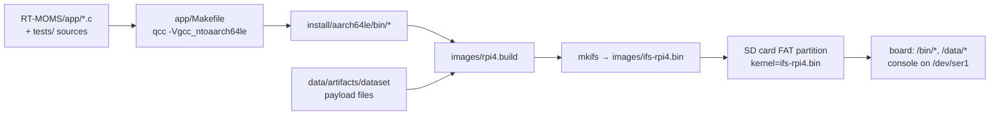

# Implementation

How the service is implemented, stage by stage, in the order a sample actually
travels: recording on disk → sensor → block loader → message definition → client
→ server → merge sort → median filter → shared results → pulse → boot image.
Every stage is **built and measured on the Raspberry Pi 4**. The commands that run
all of this are in [REPRODUCE.md](REPRODUCE.md); what they exercise and why each
stage is shaped the way it is, is here.

Paths are relative to the repository root: `app/`, `tests/`, `board/` and `images/`
live under `RT-MOMS/`, and the generated datasets are under `data/`. The
plain-language companion — organised by milestone, for explaining the project out
loud — is [STUDY-GUIDE.md](STUDY-GUIDE.md). The measurement procedures are in
[TESTING.md](TESTING.md), and the board run that produced the published figures is
[FINAL-RUN.md](FINAL-RUN.md).

---

## 0. The pipeline

| Stage | Module | Unit of work | Unit size |
| --- | --- | --- | --- |
| Replay a recording | `app/sensor.c` | one sample, one frame | 1 / 128 samples |
| Assemble the payload | `app/block_loader.c` | one block | **16 384 samples = 64 KiB** |
| Describe and validate | `app/protocol.c` | one submit | 48 B header + 64 KiB |
| Transfer | client/server | IOV: `{header, block}` | 2 parts |
| Sort a block | `app/mergesort.c` | one block, k partitions | 16 384 samples over 4 workers |
| Filter a block | `app/median.c` | one block, time order | 16 384 samples, window 3..31 |
| Publish results | `app/shm_region.c` | one slot of the region | 64 KiB sorted + 64 KiB filtered |
| Verify results | `app/shared_memory.c` | one array | bytes + FNV-1a seal |

`RT-MOMS/app/`, `RT-MOMS/tests/` and `RT-MOMS/board/` are ours. Everything else
under `RT-MOMS/` is the unmodified QNX Raspberry Pi 4 board support package: do
not edit the BSP tree itself, except `images/rpi4.build` when it is time to add a
program to the image.

---

## 1. The recording on disk

**What it is.** The workload the service consumes: multi-channel battery
recordings synthesised offline (`data/`, PyBaMM), 60 000 samples per channel,
carrying additive Gaussian sensor noise and impulsive outliers — spikes, bursts and
dropouts — at a configured 1.5 % of samples, with the corruption mask kept on the
host as the answer key.

**Two on-disk layouts, one signal.**

| Layout | File | Size | Content |
| --- | --- | --- | --- |
| Planar per-channel | `bin/channels/r1_voltage.bin` | 240 000 B | 60 000 float32, one channel |
| Interleaved record | `bin/Chen2020_c1_T25_discharge.bin` | 960 000 B | 60 000 × 4 float32: `time_s, voltage_V, current_A, temperature_K` |

Both hold the same recording, and both are exported on purpose: they are two
different access patterns (contiguous vs strided), and they disagree in field
order, which is exactly the kind of thing that silently sorts the wrong signal if
only one of them is ever exercised.

**On the board** the two files are inside the boot image, read-only, at
`/data/bin/channels/r1_voltage.bin` and `/data/bin/Chen2020_c1_T25_discharge.bin`.
Nothing is mounted and nothing is copied to the card, so a board run can never
pick up a stale payload — it is the image or nothing.

---

## 2. The virtual sensor — `app/sensor.h`, `app/sensor.c`

**Implements.** A device that replays a recording like a live sensor: values arrive
a sample at a time, on the sensor's own clock, optionally paced, never as one bulk
array.

- **Two layouts, one code path.** A sample is read at
  `window[(i - window_first) * stride + offset]`, so a planar file is
  `{offset 0, stride 1}` and an interleaved record is `{offset k, stride 4}`.
  Neither the loader nor the client knows which one it was given.
- **Bounded read-ahead, not a slurp.** The file is read through a sliding window
  (`SENSOR_WINDOW_SAMPLES` 4096 raw records, widened if the caller's frame is
  larger), refilled as the reader advances. A caller reading one sample at a time
  and a caller reading whole blocks see exactly the same values — which is what
  `test_sensor` compares.
- **Device semantics versus client semantics.** `sensor_read()` delivers at most
  one *frame* (default 128 samples); `sensor_read_block()` aggregates whole frames
  up to a requested size. A real device hands you a frame; assembling a 64 KiB
  payload is the client's job.
- **Its own clock.** `sensor_timestamp_ns()` is `index * 1e9 / rate_hz` from a
  sample counter, so timestamps are exact and independent of how fast the host
  runs. In `loop` mode the counter keeps advancing across the wrap.
- **Pacing.** `sensor_read_paced()` alternates a read with a wait so the stream
  holds the configured rate. The only platform-dependent code in the project lives
  here, behind one `#if defined(_WIN32)`: on the target it is
  `clock_gettime(CLOCK_MONOTONIC)` and `nanosleep`.
- **Every failure is named.** A missing path, an unreadable or empty file, a file
  whose size is not a whole number of float32 values or of records, an
  offset/stride/frame/rate out of range — each returns `NULL` with a sentence on
  stderr. Reads return a count, `0` for end of stream, `-1` for an error.

**Proved by** `test_sensor.c` — 15 tests, **642 checks**: exact float32 round trips
including ±0, `FLT_MIN` and a subnormal; frame capping; EOF versus looping; reset;
window refills at unaligned offsets; timestamp arithmetic; block reads; pacing; and
over the real payload, the two layouts agreeing bit for bit, the 3 + 10 848
partition, min/max and per-channel ranges. `sensor_demo` is the live trace at a
chosen rate.

---

## 3. The block loader — `app/block_loader.h`, `app/block_loader.c`

**Implements.** The recording → blocks + descriptors conversion: the payload the
client actually offloads.

- **The block is exactly 64 KiB** — `PROTO_BLOCK_SAMPLES` 16 384 float32 — so the
  "payload of at least 64 KB" requirement is met by construction, with no padding.
  The loader sets the sensor's frame size to one block, making a block a single
  read.
- **A descriptor travels with every block**: the sequence number within the stream,
  the index of the block's first sample in the recording, the sample count, the
  rate, the channel, the block's own min/max, and an FNV-1a checksum.
- **The one place that knows the file layouts.** The interleaved record is
  `[time_s, voltage_V, current_A, temperature_K]` — a *different* order from the
  `PROTO_CHANNEL_*` enumeration — so `block_loader_channel_offset()` maps channel to
  position (`voltage` is 1, not 2). A mistake here would sort the wrong signal, so
  it lives in one function and is tested for all four channels.
- **A short final block is zero-padded**, so its bytes are reproducible, its
  checksum is stable, and no stale bytes cross a process boundary. Consumers sort
  `desc.samples` values, never the padding.
- **Counters** (total samples, blocks emitted, samples emitted) exist for the report
  and the tests.

**Proved by** `test_block_loader.c` — 8 tests, **116 checks**: rejected arguments; a
synthetic 20 000-sample file splitting as 16 384 + 3616 and reassembling
bit-exactly; the real partition; **the planar and interleaved routes producing
byte-identical blocks and descriptors**; the loader → submit → server-validation
round trip; and a single changed sample being caught. `loader_demo` prints the whole
block stream with the verdict of the same validation the server applies.

---

## 4. The message definition — `app/protocol.h`, `app/protocol.c`

**Implements.** The interface both sides compile against — the "common header file"
the prerequisites ask for, and the design document in code form.

**The decisions it encodes.**

1. **The block exists as a type**: `proto_block_t` is 16 384 float32 and a static
   assertion pins its size to 65 536 bytes.
2. **The descriptor is separate from the block**, which is what lets the server
   receive a 48-byte header, validate it, and only then pull the payload with
   `MsgReadv()` — instead of needing a 64 KiB receive buffer just to learn how large
   the message is.
3. **The checksum covers exactly `desc.samples` floats**, not the whole 64 KiB: a
   short final block's tail is unused, and checksumming it would make the value
   depend on whatever happened to be in the buffer.
4. **Message types start at `0x1000`.** QNX's `<sys/iomsg.h>` puts system message
   types at `_IO_BASE 0x100 … _IO_MAX 0x1FF`; a static assertion re-checks the
   relation wherever the QNX headers are visible, so a future change fails the build
   rather than the server eating system messages.
5. **The completion pulse uses code 16**, clear of the small codes the kernel
   reserves, inside `_PULSE_CODE_MINAVAIL … _PULSE_CODE_MAXAVAIL` — also asserted at
   compile time on the target.
6. **The ack precedes the pulse, and the header says why**: an `rcvid` is only
   usable until it has been replied to, so the client supplies its own connection,
   gets the ack as soon as the job is accepted, and receives the pulse later on a
   connection it owns.
7. **A pulse carries one byte of code and one machine word** — enough for a job id,
   not for a median plus an offset plus a length. So the pulse is the notification
   and `PROTO_MSG_FETCH` is the payload.
8. **The client chooses `job_id`** and the server echoes it in the ack, the pulse
   and the result, which is how a completion is paired with its request.
9. **`proto_submit_prepare()` clears the struct before filling it**, so no stale
   padding goes on the wire and two otherwise identical submits are byte identical.
10. **Status is in the reply, not in `MsgError`.** `MsgError` is for transport
    failures; the reply status says *why* a job was refused (`PROTO_ERR_CHECKSUM`,
    `PROTO_ERR_VERSION`, …) and `proto_status_str()` turns it into a sentence.
11. **Results come back through shared memory, not through a reply** — a sorted
    block and a filtered block are 128 KiB between them. The header defines one
    named region, `PROTO_SHM_NAME` (`/dev/shmem/sortmed-results`), and the result
    message carries byte offsets into it instead of data, while the *block* still
    crosses by message, so the IOV and 64 KB properties are untouched.
12. **The rolling-filter width and threshold travel in the submit** (protocol 3):
    `filter_width` (odd 3..31) and the threshold, validated by
    `proto_submit_valid()`. One server therefore answers a sweep of widths without
    being restarted, and the default stays the build's 9.

**Proved by** `test_protocol.c` — 14 tests, **186 checks**: the 64 KiB size, the
type and pulse ranges, the first-field layout of every message, the shared region's
name and slot layout, the checksum definition and its sensitivity, byte-determinism
of `prepare`, each refusal path, and the partial-block checksum rule.

---

## 5. The client — `app/client.c`

**Implements.** The offload side: replay a recording, assemble 64 KiB blocks, send
them to the server, and report what came back.

- **`name_open` only, with a 10-second deadline** — prerequisite 7. The retry loop
  gives up and exits with a message rather than hanging; `client-wait-test.sh`
  proves both halves on the board (no server → gives up at the deadline; a server
  that starts 3 s late → the client connects by itself).
- **The block loop**: `block_loader_next()`, `proto_submit_prepare()`, `MsgSendv()`
  with two IOV parts, then the ack read and checked. A refusal (`PROTO_ERR_*`) is a
  message and a retry, never a silent skip.
- **The pulse and the fetch**: `MsgReceive()` on the client's own channel, then
  `MsgSend(fetch)` and the result — median, region offsets, `elapsed_ns` — printed
  per block with a running total.
- **The results are read from the region**, checking the header's magic and version,
  the slot's `job_id`, and each array's FNV-1a seal over the bytes actually read
  before trusting them.
- **`sorted.bin` is the client's own global sort**, written as the by-product of its
  cross-check — not the server's per-block arrays. The server's sorting is evidenced
  by the medians the pulse carried (see §13).
- **Error paths are first-class output**: no server within the deadline, a refused
  block, a fetch for an unknown job, a short final block.

---

## 6. The server — `app/server.c`

**Implements.** The service side: accept submits, validate them, do the work, answer
asynchronously.

- `name_attach("sortmed")` creates the channel and registers the name; the receive
  loop uses `MsgReceivev()` into the *header* first and `MsgReadv()` for the block
  only after the descriptor validates.
- **Validation before work**: `proto_submit_valid()` then `proto_submit_verify()`.
  Only then is the ack replied, and only then does the job take a result slot.
- **The receive loop never blocks on the sort.** A job owns a slot in the shared
  region: the block is received straight into it, and the rolling filter reads a
  time-ordered copy taken before the sort. A submit that arrives with every slot
  taken is refused with `PROTO_ERR_BUSY` rather than overwriting an uncollected
  result.
- **The completion pulse goes to the connection the client supplied**
  (`MsgSendPulse(coid, SIGEV_PULSE_PRIO_INHERIT, PROTO_PULSE_DONE, job_id)`), and
  the connection is re-resolved for **every** job — the fix that makes the second and
  later runs on one server work.
- **One pool** (`ms_pool_create`, 4 workers by default) serves every job; `ms_sort()`
  refuses a second concurrent sort rather than corrupting the shared phase state.
- `PROTO_MSG_FETCH` answers with `proto_result_t`; any other type gets a refusal.

---

## 7. The parallel merge sort — `app/mergesort.h`, `app/mergesort.c`

- **Partitions first, then merges.** `k = min(n / 1024, workers)`, so a 16 384-sample
  block on four workers is 4 partitions of 4096 and 2 merge phases.
- **The phase boundary is a barrier, not a delay.** Tasks go into a shared array
  under the mutex; each worker claims the next index, runs it, and increments a
  completion count; the last one signals `phase_done`, and the caller waits on it
  before posting the next phase. Nothing is timed, so the result cannot depend on
  machine speed.
- **One scratch buffer, ping-ponged**, one allocation per sort, none per merge.
- **Stable, therefore deterministic.** A merge takes from the left run on ties
  (`a[i] <= b[j]`), so equal values keep their arrival order and the output does not
  depend on the thread count.
- **In place, and it reports its plan.** `ms_stats()` returns partitions, merge
  phases and tasks actually run — how the tests prove the parallel path was taken.
- **Small inputs take the serial path** (`n < 4096`); **one sort per pool at a
  time**; `<pthread.h>` is the only system header, so the same source runs on the Pi.

**Measured on the board** (voltage block, width-9 sweep, per-block sort only):

| Workers | Task plan | Sort time | Scale |
| --- | --- | --- | --- |
| 1 | 1 partition, 0 phases, 1 task | 2.40 ms | 1.00× |
| 2 | 2 partitions, 1 phase, 3 tasks | 1.32 ms | 1.82× |
| 3 | 3 partitions, 2 phases, 5 tasks | 1.09 ms | 2.20× |
| 4 | 4 partitions, 2 phases, 7 tasks | 0.80 ms | **3.00×** |

The plan line changes shape with the worker count, which is what shows the parallel
path doing the work. One 64 KiB block is 163.84 s of signal at the 100 Hz design
rate and it sorts in 0.80 ms — about **200 000× real time**. The generated recording
samples unevenly (~74.8 ms per sample, 13.36 Hz), so a block spans 1226 s of *that*
stream and the headroom is larger still. The separate `test_kpi` benchmark, best of
20 runs on the board, measured 3.010 / 1.631 / 1.011 ms at 1 / 2 / 4 workers
(2.98×) on its own synthetic block.

---

## 8. The rolling median filter — `app/median.c`

- **It needs a copy, because the sort destroys the order it reads.** Sorting is a
  statistics operation on the block; the filter is a time-domain operation on the
  signal. They run on two different buffers, which is why the arriving block is
  never sorted in place.
- **The window crosses block boundaries.** The last `filter_width - 1` samples of a
  block seed the next one's window, so the filtered signal is continuous across the
  16 384-sample seams. `test_median` has a test for a spike sitting exactly on the
  seam.
- **Hampel rule.** The local median is the truth; a sample further from it than the
  threshold (4 σ by default, measured against the window's MAD) is replaced by the
  median and counted. The output never aliases the input.
- **Two medians, both reported.** The rolling median is what the result carries
  (`proto_result_t::median`); the block's own 50th percentile is what the sort
  produces as a by-product and what the cross-check compares.
- **Width and threshold are per job** (protocol 3), odd 3..31, validated by
  `proto_submit_valid()`; the build's default stays 9.
- **Single-threaded by nature** — every output needs its neighbours — but the API
  already takes `left`/`right` context arrays, so it could be split later without an
  interface change.

**The width sweep** (`tools/filter_sweep.py` over `perf-sweep.sh width`, voltage
channel, 64 KiB blocks, means over three repeats each):

| Width | Recall | Clean samples replaced | RMSE gain | Block total |
| --- | --- | --- | --- | --- |
| 3 | 36.1 % | 8.54 % | 1.01× | 2.48 ms |
| 5 | 43.6 % | 4.17 % | 1.06× | 3.70 ms |
| 7 | 58.8 % | 2.35 % | 1.35× | 5.04 ms |
| 9 — the build default | 73.8 % | 1.42 % | 6.17× | 6.69 ms |
| 11 | 82.9 % | 0.97 % | 7.06× | 8.40 ms |
| 13 | 93.8 % | 0.71 % | 9.90× | 10.20 ms |
| **15** | **98.6 %** | **0.52 %** | **12.14×** | **12.19 ms** |
| 21 | 98.9 % | 0.26 % | 12.26× | 19.73 ms |
| 31 | 98.9 % | 0.11 % | 12.21× | 35.63 ms |

15 is the knee: past it every quality number is flat within a third of a point while
the time doubles and triples. The demo run therefore passes `-w 15`; the default stays
9 so the image and its hash stay valid.

**What the filter achieved, per channel, on the width-15 board run** (against the
dataset's clean series):

| Channel | RMSE before → after | Gain | MAE before → after | p99 before → after | Replaced |
| --- | --- | --- | --- | --- | --- |
| voltage | 23.99 → 1.98 mV | 12.1× | 3.21 → 1.56 mV | 43.96 → 4.97 mV | 1 188 |
| current | 158.8 → 8.53 mA | 18.6× | 13.55 → 6.25 mA | 137.8 → 20.1 mA | 1 138 |
| temperature | 233.9 → 63.8 mK | 3.67× | 70.9 → 47.6 mK | 1.134 → 0.153 K | 1 177 |
| time | exact before and after | — | — | — | 0 |

The `time` column carries no injected corruption and came back **byte-identical** —
the evidence the filter is not over-eager. What it does not do: bursts wider than
its half-window survive; it is not a smoother (the broadband noise remains by
design); and the threshold is a deliberate trade between missing a spike and
replacing a clean sample.

**Proved by** `test_median.c` — 12 tests, **7 615 checks**: rejected arguments;
empty and tiny blocks; a clean signal untouched; a single spike removed; bursts and
dropouts; agreement with a reference Hampel implementation; block-wise output equal
to whole-signal filtering (with context); chunk edges without context behaving as
documented; a spike on a block seam; spikes removed in noise; `median_of_sorted`;
and the global median being the median of the raw data.

---

## 9. The completion pulse and the result

- **The event.** `MsgSendPulse()` with `PROTO_PULSE_DONE` (code 16) and the job id
  as the pulse value. A pulse is asynchronous by construction: the server does not
  know or care whether the client is in a receive, and the client is not holding a
  reply open while the work runs.
- **The fetch.** `PROTO_MSG_FETCH` returns the job's `proto_result_t`, because a
  pulse can carry one machine word and the result needs a median, a window width, an
  outlier count, two region offsets, a length, two checksums and a duration.
- **The memory-offset descriptor is the region plus two offsets.**
  `sorted_offset` and `filtered_offset` are byte positions from the start of the
  shared region, `length` is how many float32 values each array holds, and each
  array carries its own FNV-1a checksum — offset 0 meaning "not produced". A
  matching checksum is what lets the client prove the bytes it read out of shared
  memory are the bytes the server wrote.
- **`elapsed_ns`** is the server-side processing time, which is what the timing
  study compares across runs, thread counts and widths.

**Proved on the board**: `soak.sh 20` — twenty consecutive runs, every one
completing, every one with **identical medians**, and the pulse pairing correctly
with its job id each time. Service time averaged **7.21 ms per block** (block total
from the client's side 7.51 ms), submit 0.196 ms, fetch 0.10 ms, about 35 ms per
four-block run.

---

## 10. The shared results region — `app/shm_region.c`, `app/shared_memory.c`

**Implements.** The memory the result descriptor points into, and the arithmetic
and seals that make reading it safe.

- **The layout** (`protocol.h`): a 24-byte region header (magic, version, generation
  counter), then four slots of a 16-byte slot header plus 64 KiB sorted plus 64 KiB
  filtered — `24 + 4 × (16 + 131 072) = 524 376` bytes.
- **A state word instead of a cross-process lock.** The slot header carries a state
  word (`WR2D` when written and ready); the client reads it before touching the
  arrays. My memory is not shared with the server's lock, so a lock would need to
  live in the region itself; a state word plus the generation counter is the smaller
  mechanism.
- **Offset 0 means "not produced"**, because no real array starts at byte 0.
- **Seals on both arrays** — the client recomputes FNV-1a over exactly the bytes it
  mapped, which is the integrity the kernel would otherwise have provided by copying
  the data back in a message.

**Proved by** `test_shared_memory.c` — **13 checks** over the region bounds and
arithmetic, and by the end-to-end run: the client's arrays, read at the returned
offsets, match the host's to the bit.

---

## 11. The boot image and the console run

- `app/Makefile` builds every program for `aarch64le` and installs it into
  `install/aarch64le/bin`; `mkifs` then produces the image.
- **The image carries twelve programs**: `sortmed-server`, `sortmed-client`, the
  three demos (`sensor_demo`, `loader_demo`, `pipeline_demo`) and the seven suites
  (`test_protocol`, `test_sensor`, `test_block_loader`, `test_mergesort`,
  `test_median`, `test_shared_memory`, `test_kpi`), plus the three board scripts
  (`perf-sweep.sh`, `client-wait-test.sh`, `soak.sh`) and the payload —
  37 797 716 B, SHA-256 `2ac01f08…31fc9d8b`.
- `images/rpi4.build` places the programs in `/bin` and the payload in `/data`; both
  are optional entries, so a checkout without the generated data still builds an
  image and reports the payload tests as skipped.
- **The console is the interface**: `/dev/ser1` at 115200 8N1, a `ksh` prompt, and
  `/tmp` for the scratch files the tests write. The run sheet is
  [FINAL-RUN.md](FINAL-RUN.md).

---

## 12. Conventions

- **C99 plus libc**, deliberately: `-std=c99 -Wall -Wextra -pedantic` is clean, and
  the same sources build for the host and for `qcc -Vgcc_ntoaarch64le`. The one
  addition is POSIX threads in `app/mergesort.c`; on the target they are part of the
  C library, on the host they need a winpthreads-capable compiler, which is what
  `THREADCC` in `tests/Makefile` picks.
- **No QNX headers in host-testable code.** `protocol.h` does not include
  `<sys/neutrino.h>`; it defines the constants it needs and asserts the relations
  against QNX's values only where those headers exist.
- **Static assertions in C99** via `PROTO_STATIC_ASSERT` (a negative-size array
  typedef), rather than C11's `_Static_assert`.
- **Errors are reported, never silent**: constructors return `NULL` and say why on
  stderr; readers return a count, `0` for end of stream and `-1` for an error.
- **Deterministic bytes.** Fixed-width fields, structs cleared before use, short
  blocks zero-padded — so anything that crosses a boundary can be compared.

---

## 13. Verified numbers

| Quantity | Value |
| --- | --- |
| Host test result | **9 150 checks, 0 failed, 0 skipped** (642 sensor + 186 protocol + 116 loader + 578 mergesort + 7 615 median + 13 shared memory); `test_kpi` adds 79 benchmark checks |
| Board test result | the same six suites, the same counts, 0 failed, 0 skipped — plus `test_kpi` 79 and the three board scripts |
| Block size | 16 384 samples = 65 536 B |
| 60 000-sample recording | 3 full blocks + 10 848 samples |
| Payload bytes as blocks | 262 144 B (4 × 65 536) |
| Sort plan for one 64 KiB block, 4 workers | 4 partitions, 2 merge phases, 7 worker tasks |
| Block sort on the Raspberry Pi 4 | 2.40 → 1.32 → 1.09 → 0.80 ms at 1 / 2 / 3 / 4 workers = **3.00×** |
| Server stage per block, width 9 | 6.69 ms (sweep mean); 7.21 ms service time in the soak |
| Server stage per block, width 15 | 12.19 ms (sweep mean) |
| Filter quality, width 15 | 12.1× / 18.6× / 3.67× RMSE gain on voltage / current / temperature; 0 replacements on time |
| Real-time headroom at 100 Hz | one 64 KiB block is 163.84 s of signal, sorted in 0.80 ms |
| Cross-compile | 12/12 programs, ELF64 AArch64, no warnings under `-Wall -Wextra` |
| Boot image | 37 797 716 B, SHA-256 `2ac01f08157ded8fcb0ae132fbd732bb3f5b5756d40757f490b4e20a31fc9d8b` |
| Soak | 20 runs, all completed, all with identical medians |
| Client deadline | proven by `client-wait-test.sh`: gives up at 10 s with no server; connects when it starts 3 s late |

**The sort claim, and the evidence that backs it.** `sorted.bin` on the disk is the
*client's* global ascending order of all 60 000 samples — the by-product of its
cross-check — not the server's per-block arrays. It verifies as an ascending,
bit-exact permutation of `raw.bin`, and the server's own sorting is evidenced by the
medians: every block median in `medians.csv` is the median of that block's raw
samples, which is exactly the number the completion pulse carried. `tools/result_plots.py`
checks both on every run and prints the verdicts.

> One open discrepancy: for current, counting the bytes that actually differ gives
> 1 139 against the server's own 1 138, while voltage and temperature agree exactly.
> A single sample was counted as replaced while coming back byte-identical. It is a
> reporting nuance, not a fault in the figures, but it should be explained.

---

## 14. Testing: two folds, one set of sources

**The machinery.** No test framework: each file in `RT-MOMS/tests/` is a normal C
program that includes `test_util.h` and calls check macros (`T_CHECK`,
`T_CHECK_INT`, `T_CHECK_SIZE`, `T_CHECK_SAME_FLOAT` — the last one compares bits, so
`+0.0` and `-0.0` are not "equal"). `T_RUN(name)` prints the test's name and its
verdict; the last line is the summary and the process exit status is the verdict, so
a failure stops the run.

**Fold one — the host.** `make check` in `RT-MOMS/tests/` builds and runs the six
suites with `gcc`/`clang`: fast, easy to instrument, and able to compare against
`qsort` and feed broken input. 9 150 checks, 0 failed, 0 skipped.

**Fold two — the board.** The same sources, cross-compiled with
`qcc -Vgcc_ntoaarch64le` and running out of the boot image: a different compiler, a
different C library and a different CPU. The same counts come back — 186 / 642 /
116 / 578 / 7 615 / 13 — so the only thing that could still differ is the kernel,
which is what the shared region and the pulse exercise.

**What makes the evidence convincing** (used in both folds):

| Kind | Example | Why it convinces |
| --- | --- | --- |
| Two independent routes | planar vs interleaved; one sample at a time vs whole blocks | different code paths, so a wrong stride or window refill makes them disagree |
| An oracle | `qsort()` on the same numbers | not our code, not our bug |
| Invariants | output ordered; the multiset unchanged; seals match; byte-identical output for 1/2/3/5/8 threads | catches classes of bugs, not one example |
| Deliberate bad input | a 3-byte file, a 6-float record, a NULL path, one nudged sample, a fetch for an unknown job | proves the system refuses instead of quietly doing something wrong |

**The measurement campaign**, run on the board and scored on the host:

| Run | Script | Scored by | Where the result lives |
| --- | --- | --- | --- |
| Width sweep (3…31) | `perf-sweep.sh width` | `tools/filter_sweep.py` | §8 table; `run-figures/perf-width/` |
| Thread sweep (1…4) | `perf-sweep.sh threads` | `tools/filter_sweep.py` | §7 table; `run-figures/perf-threads/` |
| Client deadline | `client-wait-test.sh` | its own exit status | §5 |
| Repeated requests | `soak.sh 20` | identical medians + timings | §9 |
| Figures for the report | `tools/result_plots.py` | its printed checks | `run-figures/*.png` |

---

## 15. What is left

| Piece | Where it stands |
| --- | --- |
| The report | the template is converted and compiling (`report/report_template.tex`); the figures are published in `run-figures/`; the numbers are in this file, [STUDY-GUIDE.md](STUDY-GUIDE.md) and [FINAL-RUN.md](FINAL-RUN.md) |
| The deck's run figures | `presentation/beamer/assets/run_*.png` are re-rendered copies of the width-9 figures and are now stale against the width-15 run |
| The one-sample discrepancy | current: 1 139 byte-differing samples against the server's 1 138 (§13) |

The protocol was written first on purpose: it fixes the interface the sort, the
filter and the IPC must all satisfy, and it is the one part that can be proved
correct before any QNX code exists.
