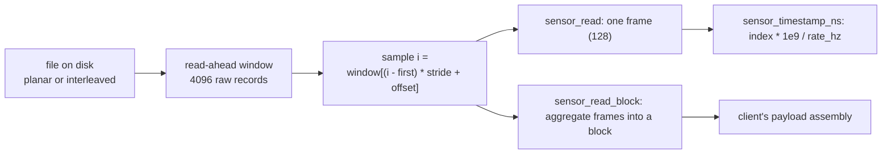
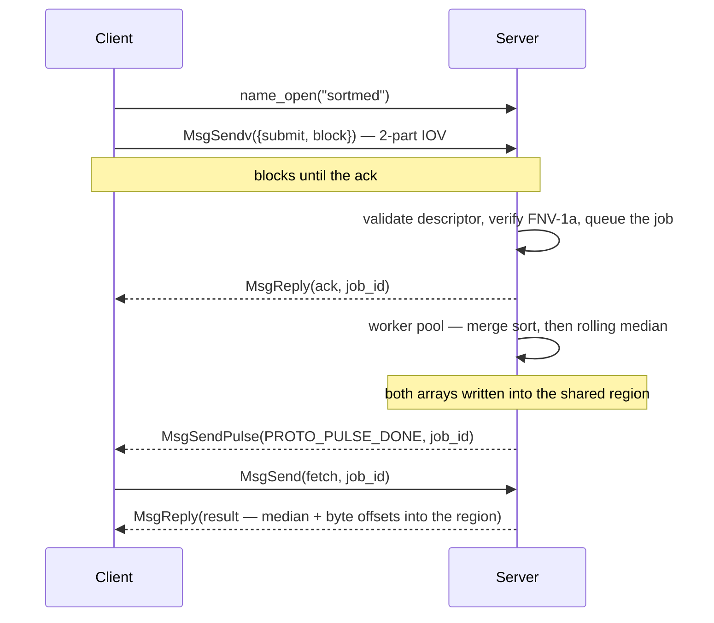
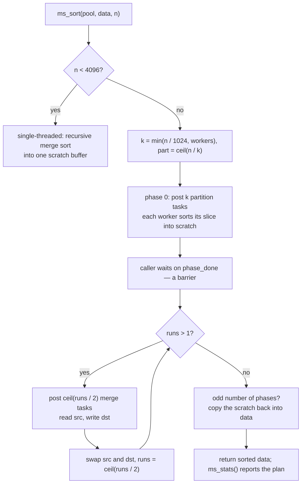
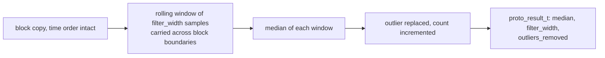
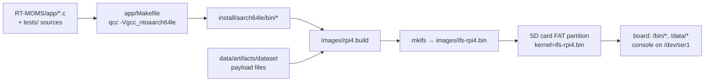

# Implementation

How the service is implemented, stage by stage, in the order a sample actually
travels: recording on disk → sensor → block loader → message definition → client
→ server → merge sort → median filter → pulse and result → boot image. The
commands that run all of this are in [REPRODUCE.md](REPRODUCE.md); this file
explains what they exercise and why each stage is shaped the way it is.

Paths below are relative to the repository root: `app/`, `tests/` and `images/`
all live under `RT-MOMS/`, and the generated datasets are under `data/`. A
plain-language companion, organised by milestone and written for explaining the
project out loud, is in [STUDY-GUIDE.md](STUDY-GUIDE.md).

Stages are marked **[built]** when the code exists and has been run (host and, for
everything in the image, on the board), and **[planned]** when only the interface
for it exists so far. Nothing here follows the milestone numbering — that lives in
`milestones-draft.md`; this is the machine itself.

---

## 0. The pipeline

```mermaid
flowchart LR
    A["1 Recording on disk<br/>float32, two layouts"] --> B["2 Virtual sensor<br/>sample / frame stream — built"]
    B --> C["3 Block loader<br/>64 KiB block + descriptor — built"]
    C --> D["4 Message definition<br/>app/protocol.h — built"]
    D --> E["5 Client<br/>name_open + MsgSendv IOV — built"]
    E --> F["6 Server<br/>name_attach + MsgReadv — built"]
    F --> G["7 Parallel merge sort<br/>worker pool, k partitions — built"]
    G --> H["8 Rolling median filter<br/>time-ordered copy — built"]
    H --> I["9 Pulse + fetch + result<br/>built"]
    I --> J["10 Boot image + console run<br/>images/rpi4.build — built"]
```

Every stage is built and measured, and the same pipeline is what the host tests
exercise, with stages 5, 6 and 8 replaced by a direct function call — that is
the whole point of keeping every stage QNX-free except the two that talk to the
kernel. What remains is the measurement campaign and the report: the sweeps on
the board and their scoring are in `TESTING.md`, and since protocol 3 the
rolling-filter width travels in the submit itself, so one server answers a sweep
of widths without being restarted.

| Stage | Module | Unit of work | Unit size |
| --- | --- | --- | --- |
| Replay a recording | `app/sensor.c` | one sample, one frame | 1 / 128 samples |
| Assemble the payload | `app/block_loader.c` | one block | **16384 samples = 64 KiB** |
| Sort a block | `app/mergesort.c` | one block, k partitions | 16384 samples over 4 workers |
| Describe and validate | `app/protocol.c` | one submit | 48 B header + 64 KiB |
| Transfer (M3) | client/server | IOV: `{header, block}` | 2 parts |

`RT-MOMS/app/` and `RT-MOMS/tests/` are ours. Everything else under `RT-MOMS/` is
the unmodified QNX Raspberry Pi 4 board support package: do not edit the BSP tree
itself, except `images/rpi4.build` when it is time to add a program to the image.

---

## 1. The recording on disk — **[built]**

**What it is.** The workload the service consumes: multi-channel battery
recordings synthesised offline (`data/`, PyBaMM), 60 000 samples per channel at
100 Hz, carrying additive Gaussian sensor noise and impulsive outliers — spikes,
bursts and dropouts — at a configured 1.5 % of samples, with the corruption mask
kept on the host as the answer key.

**Two on-disk layouts, one signal.**

| Layout | File | Size | Content |
| --- | --- | --- | --- |
| Planar per-channel | `bin/channels/r1_voltage.bin` | 240 000 B | 60 000 float32, one channel |
| Interleaved record | `bin/Chen2020_c1_T25_discharge.bin` | 960 000 B | 60 000 × 4 float32: `time_s, voltage_V, current_A, temperature_K` |

Both hold the same recording, and both are exported on purpose: they are two
different access patterns (contiguous vs strided), and they disagree in field
order, which is exactly the kind of thing that silently sorts the wrong signal if
only one of them is ever exercised.

**On the board** the two files are inside the boot image, read-only, at
`/data/bin/channels/r1_voltage.bin` and
`/data/bin/Chen2020_c1_T25_discharge.bin`. Nothing is mounted and nothing is
copied to the card, so a board run can never pick up a stale payload — it is the
image or nothing.

---

## 2. The virtual sensor — `app/sensor.h`, `app/sensor.c` — **[built]**

**Implements.** A device that replays a recording like a live sensor: values
arrive a sample at a time, on the sensor's own clock, optionally paced, never as
one bulk array. This is what stands in for hardware until the client is fed by
one.

**How.**

- **Two layouts, one code path.** A sample is read at
  `window[(i - window_first) * stride + offset]`, so a planar file is
  `{offset 0, stride 1}` and an interleaved record is `{offset k, stride 4}`.
  Both `.bin` flavours of the dataset are just configuration, and neither the
  loader nor the client knows which one it was given.
- **Bounded read-ahead, not a slurp.** The file is read through a sliding window
  (`SENSOR_WINDOW_SAMPLES` 4096 raw records, widened if the caller's frame is
  larger), refilled as the reader advances. The module behaves like a device with
  a prefetch buffer: a caller reading one sample at a time and a caller reading
  whole blocks see exactly the same values, which is what lets `test_sensor`
  compare the two routes.
- **Device semantics versus client semantics.** `sensor_read()` delivers at most
  one *frame* (default 128 samples); `sensor_read_block()` aggregates whole
  frames up to a requested size. A real device hands you a frame; assembling a
  64 KiB payload is the client's job, not the device's.
- **Its own clock.** `sensor_timestamp_ns()` is `index * 1e9 / rate_hz` from a
  sample counter, so timestamps are exact and independent of how fast the host
  runs. In `loop` mode the counter keeps advancing across the wrap, like a sensor
  that never stops.
- **Pacing.** `sensor_read_paced()` alternates a read with a wait so the stream
  holds the configured rate. The only platform-dependent code in the project is
  that clock and that wait, behind one `#if defined(_WIN32)`: on the target it is
  `clock_gettime(CLOCK_MONOTONIC)` and `nanosleep`.
- **Every failure is named.** A missing path, an unreadable or empty file, a file
  whose size is not a whole number of float32 values or of records, an
  offset/stride/frame/rate out of range — each returns `NULL` with a sentence on
  stderr. Reads return a count, `0` for end of stream, `-1` for an error.

**Proved by** `test_sensor.c` (15 tests, 642 checks): exact float32 round trips
including ±0, `FLT_MIN` and a subnormal; frame capping; EOF versus looping; reset;
window refills at unaligned offsets; timestamp arithmetic; block reads; pacing;
and over the real payload, the two layouts agreeing bit for bit, the
3 + 10 848 partition, min/max and per-channel ranges. `sensor_demo` is the live
trace at a chosen rate.

---

## 3. The block loader — `app/block_loader.h`, `app/block_loader.c` — **[built]**

**Implements.** The recording → blocks + descriptors conversion: the payload the
client will actually offload.

**How.**

- **The block is exactly 64 KiB** — `PROTO_BLOCK_SAMPLES` 16384 float32 — so the
  "payload of at least 64 KB" requirement is met by construction, with no
  padding. The loader sets the sensor's frame size to one block, which makes a
  block a single read.
- **A descriptor travels with every block**: the sequence number within the
  stream, the index of the block's first sample in the recording, the sample
  count, the rate, the channel, the block's own min/max, and an FNV-1a checksum.
- **The one place that knows the file layouts.** The interleaved record is
  `[time_s, voltage_V, current_A, temperature_K]` — a *different* order from the
  `PROTO_CHANNEL_*` enumeration — so `block_loader_channel_offset()` maps channel
  to position (`voltage` is 1, not 2). A mistake here would sort the wrong
  signal, so it lives in one function and is tested for all four channels.
- **A short final block is zero-padded**, so its bytes are reproducible, its
  checksum is stable, and no stale bytes from another buffer cross a process
  boundary. Consumers sort `desc.samples` values, never the padding.
- **Counters** (total samples, blocks emitted, samples emitted) exist for the
  report and for the tests.

**Proved by** `test_block_loader.c` (8 tests, 116 checks): rejected arguments; a
synthetic 20 000-sample file splitting as 16 384 + 3616 and reassembling
bit-exactly; the real partition; **the planar and interleaved routes producing
byte-identical blocks and descriptors**; the loader → submit → server-validation
round trip; and a single changed sample being caught. `loader_demo` prints the
whole block stream with the verdict of the same validation the server applies.

---

## 4. The message definition — `app/protocol.h`, `app/protocol.c` — **[built]**

**Implements.** The interface both sides compile against — the "common header
file" the prerequisites ask for, and the design document in code form. This is
the file to read to understand the protocol; its own header comment carries the
message flow as a diagram.

**How, and the decisions it encodes.**

1. **The block exists as a type**: `proto_block_t` is 16384 float32 and a static
   assertion pins its size to 65 536 bytes.
2. **The descriptor is a separate struct from the block**, which is what lets the
   server receive a 48-byte header, validate it, and only then pull the payload
   with `MsgReadv()` — instead of needing a 64 KiB receive buffer just to learn
   how large the message is.
3. **The checksum covers exactly `desc.samples` floats**, not the whole 64 KiB: a
   short final block's tail is unused, and checksumming it would make the value
   depend on whatever happened to be in the buffer.
4. **Message types start at `0x1000`.** QNX's `<sys/iomsg.h>` puts system message
   types at `_IO_BASE 0x100 … _IO_MAX 0x1FF`; application messages must stay
   clear of it. A static assertion re-checks the relation wherever the QNX headers
   are visible, so a future change fails the build rather than the server eating
   system messages.
5. **The completion pulse uses code 16**, clear of the small codes the kernel
   reserves, inside `_PULSE_CODE_MINAVAIL … _PULSE_CODE_MAXAVAIL` — also
   asserted at compile time on the target.
6. **The ack precedes the pulse, and the header says why**: an `rcvid` is only
   usable until it has been replied to, so a server cannot deliver a late event
   through one it has already answered. The client therefore supplies its own
   connection, gets the ack as soon as the job is accepted, and receives the pulse
   later, on a connection it owns.
7. **A pulse carries one byte of code and one machine word** — enough for a job
   id, not for a median plus an offset plus a length. So the pulse is the
   notification and `PROTO_MSG_FETCH` is the payload.
8. **The client chooses `job_id`** and the server echoes it in the ack, the pulse
   and the result, which is how a completion is paired with the request that
   caused it.
9. **`proto_submit_prepare()` clears the struct before filling it**, so no stale
   padding goes on the wire and two otherwise identical submits are byte
   identical.
10. **Status is in the reply, not in `MsgError`.** `MsgError` is for transport
    failures; the reply status says *why* a job was refused (`PROTO_ERR_CHECKSUM`,
    `PROTO_ERR_VERSION`, …) and `proto_status_str()` turns it into a sentence for
    the log.
11. **Results come back through shared memory, not through a reply.** A sorted
    block and a filtered block are 128 KiB between them, and copying that back as
    a message would move it twice for no reason. So the header also defines one
    named region — `PROTO_SHM_NAME`, `/dev/shmem/sortmed-results` — with a fixed
    layout: a header carrying magic, version and a generation counter, then four
    slots of a slot header plus a sorted array and a filtered array. The result
    message carries byte offsets into that region instead of data, while the
    *block* still crosses by message, so the IOV and 64 KB properties are
    untouched. On QNX a leading `/` puts the object in `/dev/shmem`, and the
    library is plain libc — no extra library in either Makefile.

**Validation the server will run is already implemented and tested**:
`proto_block_desc_valid()` for the descriptor, `proto_submit_valid()` for type,
version and descriptor, and `proto_submit_verify()` for "does the block match the
checksum the descriptor claims". `test_protocol.c` (12 tests, 137 checks) pins the
64 KiB size, the type and pulse ranges, the first-field layout of every message,
the shared region's name and slot layout, the checksum definition and its
sensitivity, byte-determinism of `prepare`, and each refusal path.

---

## 5. The client — `app/client.c` — **[built]**

**Implements.** The offload side: replay a recording, assemble 64 KiB blocks,
send them to the server, and report what came back. Prerequisites it must satisfy:
`name_open` only, a 10-second connect deadline, every return value checked, and a
64 KiB payload crossing the wire.

**What already exists for it.** The whole right-hand side of stages 4 and 5 in the
header: the service name (`sortmed`), the two-part IOV submit, the job id, the
ack, the pulse code, the fetch and the result. The sensor and loader already
produce exactly what the submit message wants.

**What M3 writes.**

- A retry loop around `name_open("sortmed")` that gives up after 10 seconds and
  exits with a message, rather than hanging — prerequisite 7, and the reason the
  deadline is a property of the client and not of the server.
- The block loop: `block_loader_next()` for each block, `proto_submit_prepare()`,
  `MsgSendv()` with two IOV parts (`{submit}` and the block), then the ack read
  and checked. A refusal (`PROTO_ERR_*`) is a message and a retry, never a silent
  skip.
- `MsgReceive()` on the client's own connection for the pulse, then
  `MsgSend(fetch)` and the result: the median, the two region offsets and
  `elapsed_ns` printed per block, plus a running total.
- Mapping the results region once the service answers: `shm_open(PROTO_SHM_NAME,
  O_RDONLY)` and `mmap`, check the header's magic and version, then read each
  result at the offsets it names — checking the slot's `job_id` against the
  result's, and the array's checksum over the bytes read, before trusting them.
- Error paths as first-class output: no server within the deadline, a refused
  block, a pulse that never arrives (a receive timeout), and a short final block.

---

## 6. The server — `app/server.c` — **[built]**

**Implements.** The service side: accept submits, validate them, do the work, and
answer asynchronously. The exchange both sides implement is the sequence diagram
in stage 5.

**How it is shaped.**

- `name_attach("sortmed")` creates the channel and registers the name, then the
  receive loop uses `MsgReceivev()` into the *header* first and `MsgReadv()` for
  the block only after the descriptor validates — the two-part shape stage 4 was
  designed for.
- Validation before work: `proto_submit_valid()` then `proto_submit_verify()`
  against the block. Only then is the ack replied, and only then does the job join
  the work queue.
- The receive loop must never block on the sort, or the next submit would wait
  behind it. A job owns a slot in the shared region: the block is received
  straight into it, and the rolling filter reads a time-ordered copy taken before
  the sort — sorting destroys the order the filter needs. A submit that arrives
  with every slot taken is refused with `PROTO_ERR_BUSY` rather than overwriting a
  result the client has not collected yet.
- The completion pulse goes to the connection the client supplied, so the server
  keeps a per-job `rcvid`/connection id next to the job, and `PROTO_MSG_FETCH`
  answers with `proto_result_t`.
- The pool rules from stage 7 apply: a pool sorts one array at a time, so either
  one pool with a serialized driver or one pool per concurrent job — a decision to
  make with the M4 timing study in hand, and the reason `ms_sort()` refuses a
  second concurrent call rather than corrupting the shared phase state.

---

## 7. The parallel merge sort — `app/mergesort.h`, `app/mergesort.c` — **[built]**

**Implements.** The sort the server runs on each block, on a pool of POSIX worker
threads, with the phase structure held together by a mutex and two condition
variables.

**How.**

- **Partitions first, then merges.** A sort of `n` values over `k` partitions is
  `log2(k)` merge phases: phase 0 has the workers sort one partition each, phase
  1 merges pairs of partitions, and so on until a single run covers the array.
  `k` is `min(n / 1024, workers)`, so a 16 384-sample block on four workers is
  4 partitions and 2 merge phases.
- **The phase boundary is a barrier, not a delay.** A phase's tasks go into a
  shared array under the mutex; each worker claims the next index, runs it, and
  increments a completion count; the worker that finishes the last task signals
  `phase_done`, and the caller waits on that condition before posting the next
  phase. That dependency is real — a merge reads two runs the previous phase
  produced — and nothing is timed, so the result cannot depend on machine speed.
- **One scratch buffer, ping-ponged** between the caller's array and one
  `n`-float buffer, which doubles as the scratch for the phase-0 partitions (each
  partition owns its slice). One allocation per sort, none per merge.
- **Stable, therefore deterministic.** A merge takes from the left run on ties, so
  equal values keep the order they arrived in and the output does not depend on
  the thread count — `test_mergesort` asserts that bit for bit.
- **In place, and it reports its plan.** The sorted values end up in the caller's
  buffer; `ms_stats()` returns the partitions, the merge phases and the tasks the
  workers actually ran, which is how the tests prove the parallel path was taken
  rather than the serial fallback.
- **Small inputs take the serial path** (`n < 4096`), where a pool costs more than
  it saves, and **one sort per pool at a time**: a second concurrent `ms_sort()`
  is refused instead of corrupting the shared phase state.
- **Nothing QNX-specific**: `<pthread.h>` is the only system header, and QNX's C
  library provides POSIX threads, so the same source runs on the Pi.

**Proved by** `test_mergesort.c` (13 tests, 578 checks) — 578 checks, 0 failed, 0
skipped on the board with the payload — and by `pipeline_demo`, the compute half
of the service without the IPC:

| Workers | Task plan | Raspberry Pi 4, per 64 KiB block | This host, per block |
| --- | --- | --- | --- |
| 1 | 1 partition, 0 phases, 1 task | 2.278 ms | 0.74–1.06 ms |
| 2 | 2 partitions, 1 phase, 3 tasks | 1.253 ms | 0.42 ms |
| 4 | 4 partitions, 2 phases, 7 tasks | 0.757 ms | 0.25–0.44 ms |

1 → 4 workers is 3.01× on the board, and one 64 KiB block is 163.84 s of signal at
the 100 Hz design rate — the sort finishes that block in 0.757 ms, about 216 000×
real time as a rate. The generated recording is not uniformly sampled: its own
time column advances ~74.8 ms per sample (13.36 Hz, 4489.8 s over its 60 000
samples), so one block spans 1226 s of *that* stream and the headroom is larger
still. The plan line changing shape with the worker count is what shows the
parallel path doing the work, not just a faster serial one.

---

## 8. The rolling median filter — `app/median.c` — **[built]**

**Implements.** Outlier removal on the time-ordered signal, and the median the
result carries.

**How it is shaped.**

- **It needs a copy, because the sort destroys the order it reads.** Sorting a
  block of samples is a statistics operation on the block; the filter is a
  time-domain operation on the signal. They therefore run on two different
  buffers, which is why the arriving block is never sorted in place and why the
  median-filter module takes its own input buffer.
- **The window crosses block boundaries.** The last `filter_width - 1` samples of
  a block seed the window of the next one, so the filtered signal is continuous
  across the 16 384-sample seams instead of restarting at each block — a detail
  that only shows up if a block boundary happens to cut through a burst of
  outliers, which the payload's corruption mask can check.
- **Two medians, both reported.** The rolling median is the filtered value the
  result carries (`proto_result_t::median`, with `filter_width` and
  `outliers_removed`); the block's own 50th percentile, which the sort produces as
  a by-product, is what `pipeline_demo` prints today and is a useful independent
  check on the same data.
- **Open decisions for M3**, to be fixed before writing it: the window width (odd,
  and small enough to stay local), whether an outlier is replaced by the window
  median or left in place and only counted (`proto_result_t` records both the
  count and the filtered median, so both are available), and whether the filter
  runs on the raw block or after a first-pass sort.

---

## 9. The completion pulse and the result — **[built]**

**Implements.** Prerequisite 10: the server tells the client asynchronously, and
the client can then collect "the calculated median and memory-offset descriptor"
the project statement asks for.

- **The event.** `MsgSendPulse()` with `PROTO_PULSE_DONE` (code 16) and the job id
  as the pulse value. A pulse is asynchronous by construction: the server does not
  know or care whether the client is in a receive, and the client is not holding a
  reply open while the work runs — the reason the ack is sent early (stage 4,
  point 6).
- **The fetch.** `PROTO_MSG_FETCH` asks for the job's `proto_result_t`, because a
  pulse can carry one machine word and the result needs a median, a window width,
  an outlier count, two region offsets, a length, two checksums and a duration.
- **The memory-offset descriptor is the region plus two offsets.**
  `sorted_offset` and `filtered_offset` are byte positions from the start of the
  shared region, `length` is how many float32 values each array holds, and each
  array carries its own FNV-1a checksum — offset 0 meaning "not produced". A
  matching checksum is what lets the client prove the bytes it read out of shared
  memory are the bytes the server wrote, which is the integrity the kernel would
  otherwise have provided by copying the data back in a message.
- **`elapsed_ns`** is the server-side processing time, which is what the M4 timing
  study compares across runs, thread counts and block sizes.

**What M4 adds:** the wiring in both programs, a repeated-request run to show the
pulse arriving per job and pairing correctly with its job id, and the validation
of the returned median and of the arrays at the returned offsets against the host.

---

## 10. The boot image and the console run — **[built]**

**Implements.** Delivery: the board runs the programs out of the boot image, with
nothing copied to the card and nothing mounted.

**How.**

- `app/Makefile` builds every program for `aarch64le` and installs it into
  `install/aarch64le/bin`; the top-level `make` in `RT-MOMS/` runs it, then
  `mkifs` produces the image.
- `images/rpi4.build` places the programs in `/bin` and the payload in `/data`
  (those entries are optional, so a checkout without the generated data still
  builds an image — it just reports the payload tests as skipped).
- The image currently carries twelve programs, the three board scripts and the
  payload in 37 797 716 B; `dumpifs images/ifs-rpi4.bin` lists them back out,
  which is the check that they are really inside.
- The console is the interface: `/dev/ser1` at 115200 8N1, a `ksh` prompt, and
  `/tmp` for the scratch files the tests write. The board's own runs are recorded
  in `REPRODUCE.md` section 8, including which lines still have to be captured.

---

## 11. Conventions

- **C99 plus libc**, deliberately: `-std=c99 -Wall -Wextra -pedantic` is clean,
  and the same sources build for the host and for `qcc -Vgcc_ntoaarch64le`. The
  one addition is POSIX threads in `app/mergesort.c`: on the target they are part
  of the C library, on this host they need a winpthreads-capable compiler, which
  is what `THREADCC` in `tests/Makefile` picks.
- **No QNX headers in host-testable code.** `protocol.h` deliberately does not
  include `<sys/neutrino.h>`; it defines the constants it needs and asserts the
  relations against QNX's values only where those headers exist.
- **Static assertions in C99** via `PROTO_STATIC_ASSERT` (a negative-size array
  typedef), rather than C11's `_Static_assert`.
- **Errors are reported, never silent**: constructors return `NULL` and say why on
  stderr; readers return a count, `0` for end of stream and `-1` for an error.
- **Deterministic bytes.** Fixed-width fields, structs cleared before use, short
  blocks zero-padded — so anything that crosses a boundary can be compared.

---

## 12. Verified numbers

| Quantity | Value |
| --- | --- |
| Host test result | 9 150 checks, 0 failed, 0 skipped (642 sensor + 186 protocol + 116 loader + 578 mergesort + 7 615 median + 13 shared memory) |
| Board test result | `test_mergesort` 578, `test_block_loader` 116 and the payload suites — 0 failed, 0 skipped each; `FINAL-RUN.md` §5 has the per-suite state |
| Block size | 16384 samples = 65536 B |
| 60 000-sample recording | 3 full blocks + 10 848 samples |
| Payload bytes as blocks | 262 144 B (4 × 65 536) |
| Sort plan for one 64 KiB block, 4 workers | 4 partitions, 2 merge phases, 7 worker tasks |
| Block sort on the Raspberry Pi 4, 4 workers | 0.757 ms per block, 75.55 MiB/s, 21.6 M samples/s |
| Thread scaling on the Pi 4 | 2.278 ms → 1.253 ms → 0.757 ms per block at 1, 2, 4 workers: 3.01× |
| Real-time headroom at 100 Hz | one 64 KiB block is 163.84 s of signal, sorted in 0.757 ms |
| Cross-compile | 12/12 programs, ELF64 AArch64, no warnings under `-Wall -Wextra` |
| Boot image carrying the programs | 37 797 716 B, SHA-256 `2ac01f08…31fc9d8b` — the service, the suites and the three board scripts |
| Filter width | per job since protocol 3: `proto_submit_t.filter_width`, odd 3..31, checked by `proto_submit_valid()`; the server's default stays 9 |

---

## 13. What is left

Everything the service needs is built, and it ran on the board (`FINAL-RUN.md`).
What remains is the measurement campaign and the write-up:

| Piece | Milestone | Where it stands |
| --- | --- | --- |
| The width sweep on the board | M4 | `sh /bin/perf-sweep.sh width`, scored by `tools/filter_sweep.py` — `TESTING.md` §3.3 and §4 |
| The thread sweep | M4 | `sh /bin/perf-sweep.sh threads` — `TESTING.md` §3.4 |
| Prerequisite 7, demonstrated on hardware | M3 | `sh /bin/client-wait-test.sh` — `TESTING.md` §3.5 |
| Behaviour under repeated requests | M4 | `sh /bin/soak.sh` — `TESTING.md` §3.6 |
| The report's results section | M4 | the tables and figures those runs write, plus the block diagram and flowchart the brief asks for |

The protocol was written first on purpose: it fixes the interface the sort, the
filter and the IPC must all satisfy, and it is the one part that can be proved
correct before any QNX code exists.
